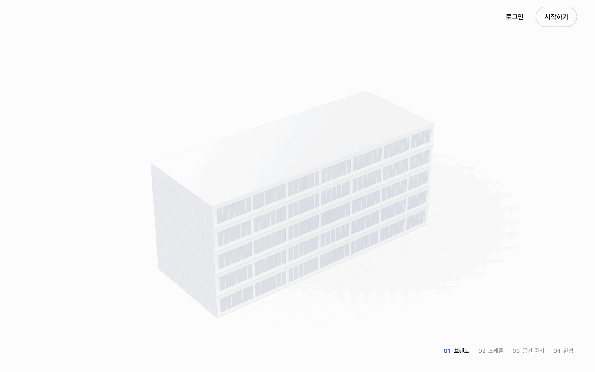
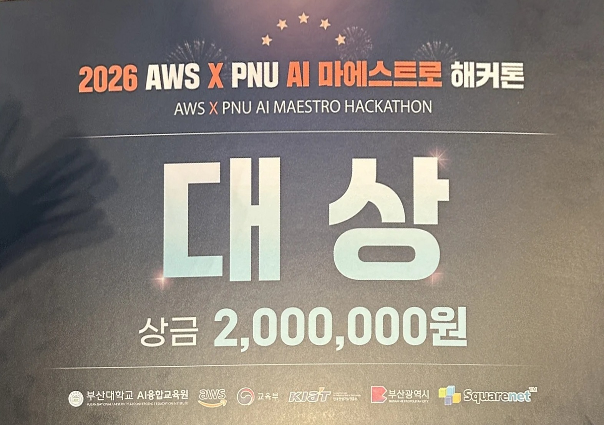
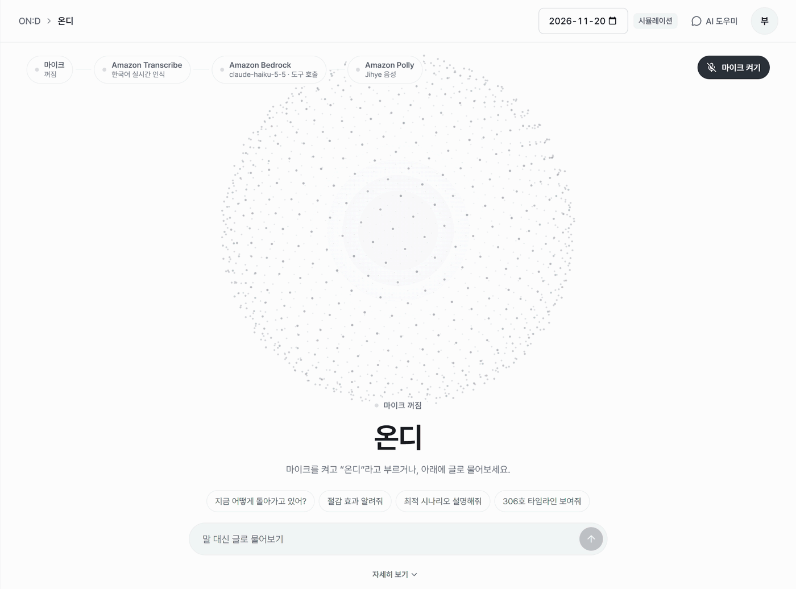
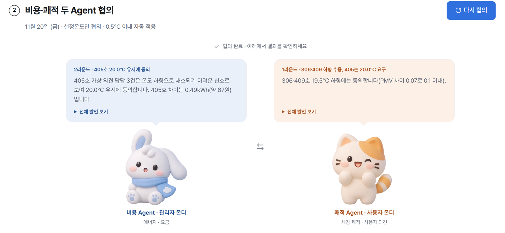
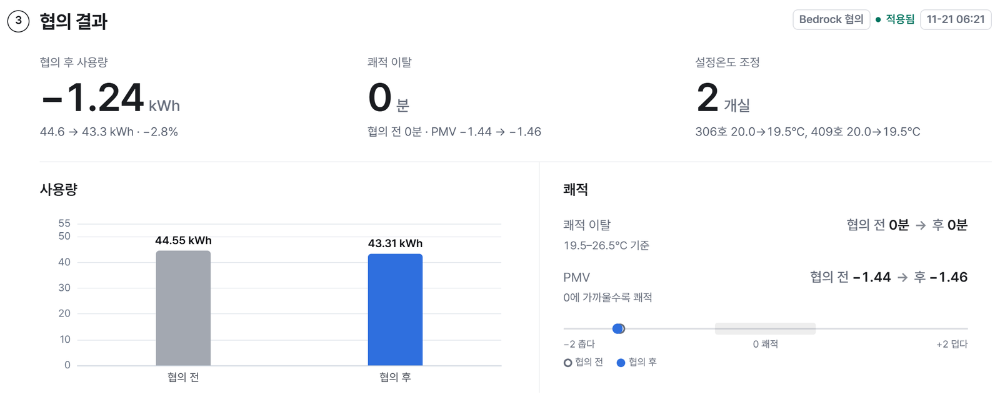
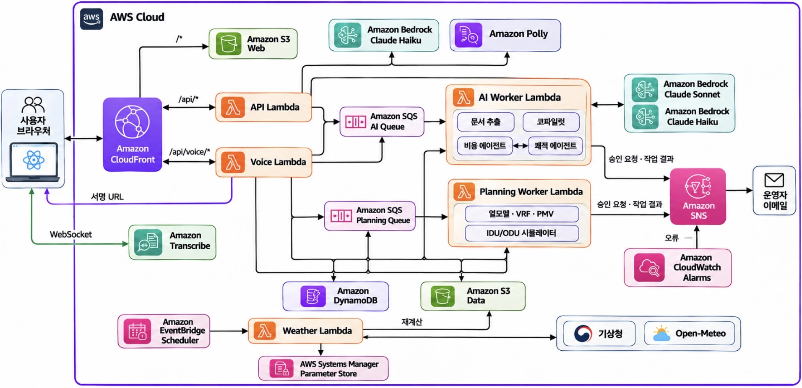

<div align="center">



# ON:D

### 사람이 오기 전, 공간을 먼저 준비합니다

시간표를 읽고, 날씨를 보고, 필요한 강의실만 미리 냉난방하는<br>
**스케줄 기반 HVAC 자동 운전 AI**


</div>

<br>

## 🏆 대상 수상



**2026 AWS x PNU AI 마에스트로 해커톤 · 과제 3 (Cloud) · 대상**

부산대학교 IT관 강의 시간표와 기상청·Open-Meteo 날씨로 강의실별 냉난방 운전 계획을 자동으로 만들고, 실내기(IDU)·실외기(ODU) 시뮬레이터로 실행 이력을 남기고, 강의 시간과 맞았는지 검증하고, 기존 방식 대비 절감 효과를 보여 주는 시설 담당자용 웹 서비스입니다.

<br>

## 👥 팀

<div align="center">

| 전동훈 | 정의진 | 이동민 | 김효정 |
|:---:|:---:|:---:|:---:|

</div>

<br>

## 💡 문제와 해결

| 지금 | ON:D |
|---|---|
| 중앙에서는 최대·최소 온도만 정하고, 강의실마다 사람이 켜고 끕니다 | 시간표와 행사 일정으로 **쓰는 공간만** 켭니다 |
| 수업 시작에 맞춰 켜서 시작 직후에는 춥거나 덥습니다 (학기 중 수업 시작 시 저온 367회) | 열모델과 예보로 강의실마다 **켜는 시각을 계산해 미리** 준비합니다 |
| 18:00 일괄 차단 뒤 저녁 수업은 냉난방 없이 진행됩니다 | 수업이 있는 강의실은 **끝날 때까지** 운전합니다 |
| 절약과 쾌적이 부딪히면 담당자 감으로 정합니다 | 비용 AI와 쾌적 AI가 **시뮬레이터로 검증하며 협의**하고, 담당자가 승인합니다 |

<br>

## ✨ 핵심 기능

### 1. 온디: 말로 운영하는 음성 비서



"지금 어떻게 돌아가고 있어?", "다음 주 수요일 405호 휴강 처리해줘"처럼 말로 묻습니다. **Amazon Transcribe**가 받아 적고, **Bedrock Claude**가 운영 도구 11개(현황, 절감 효과, 강의실 상태, 일정, 의견, 계획 설명, 시나리오 계산, 규칙 시뮬레이션, 최적화 실행, 화면 이동, 코파일럿 인계)를 직접 호출해 답을 만들고, **Amazon Polly**가 읽어 줍니다. 생각하는 동안 구는 보라색으로, 말하는 동안 초록색으로 움직입니다. 휴강 같은 일정 변경은 위 장면처럼 **AI 코파일럿 패널로 넘겨** 초안을 만들고, 담당자가 확인 버튼을 눌러야 반영합니다.

<sub>실제 Bedrock·Polly 호출로 녹화한 화면입니다. 입력은 마이크 대신 글로 했습니다.</sub>

### 2. 비용 AI × 쾌적 AI: 두 에이전트의 설정온도 협의

<table>
<tr>
<td align="center" width="50%"><br><b>비용 Agent · 관리자 온디</b><br><sub>에너지 · 요금</sub></td>
<td align="center" width="50%"><br><b>쾌적 Agent · 사용자 온디</b><br><sub>체감 쾌적 · 사용자 의견</sub></td>
</tr>
</table>

전기요금을 줄이려는 **비용 Agent** 와 이용자 쾌적을 지키려는 **쾌적 Agent** 가 강의실별 설정온도를 주고받습니다. 두 에이전트는 말하기 전에 **시뮬레이터를 도구로 직접 호출**해 자기 안을 계산하고, 매 제안은 엔진이 다시 검증하며, 최종 판정은 LLM이 아닌 **결정적 규칙**이 합니다.

> **LLM proposes, simulator verifies, rule decides.**





<sub>배포 서비스에서 실제 Bedrock으로 진행한 11월 20일 협의 기록입니다(백업 데이터로 재현). 1라운드에서 쾌적 Agent가 405호는 20.0℃ 유지를 요구했고, 2라운드에서 비용 Agent가 받아들여 합의했습니다. 결과적으로 306·409호만 20.0→19.5℃로 내려 쾌적 이탈 없이 하루 1.24 kWh를 줄였습니다.</sub>

### 3. 건물 설정과 중앙 제어 연결

건물을 말로 설명하면 AI가 프로필로 정리하고 → 중앙 제어 연결(현장 게이트웨이·직접 연결·파일 업로드 중 선택, 주소·프로토콜 입력, 연결 테스트) → 설비·운영 정보(허용 온도 범위, 현재 운전 시간)를 정합니다. 현장 게이트웨이(`gateway/edge_gateway.py`)는 건물 내부망에서 BACnet/IP로 중앙제어기와 통신하고, 클라우드로는 바깥으로 나가는 HTTPS만 씁니다.

### 4. 1·2·3차 계획과 검증

월간 기본 계획 → 주간 조정(예보·행사·의견·재실·CO₂) → 일일 검증(실황·센서·의견). 강의실별 간트로 강의·계획·실행·실내온도를 한눈에 맞춰 보고, 계획 검증과 실행 검증을 두 단계로 확인합니다.

<br>

## 📊 핵심 결과 (2026-2학기, IT관 10개 강의실, 시뮬레이션)

<!-- numbers:README:start -->
_2026-11-20T02:53+09:00 기준 배포 API에서 자동 생성 (엔진 v13)._

| 전략 | 전력량 | 전기요금 | 쾌적 시간 | 불쾌 지표(K·분) | 최대 피크 |
|---|---|---|---|---|---|
| 고정 스케줄 | 6,365 kWh | 749,938원 | 99.88% | 391 | 45.1 kW |
| 수동 운영 | 3,626 kWh | 428,407원 | 98.44% | 11,889 | 28.4 kW |
| 규칙 기반 | 2,993 kWh | 346,868원 | 98.51% | 3,775 | 24.9 kW |
| **AI 예측 제어** | 2,864 kWh | 326,416원 | 99.94% | 32 | 24.7 kW |

- 학기 전체(9/1~12/18): AI 예측 제어는 고정 스케줄 대비 **55.0% 절감**, 수동 운영 대비 21.0%, 규칙 기반 대비 4.3% 절감합니다. 전기요금은 749,938원 → 326,416원, CO₂는 1,461 kg 줄어듭니다.
- 오늘(2026-11-20)까지: 고정 대비 50.4%, 규칙 기반 대비 9.3% 절감.
- **같은 쾌적도 기준**: 규칙 기반이 AI의 쾌적도에 다가가려면 30분 전에 켜야 하고 3,254 kWh를 씁니다(수업 시작 시 저온 16회). AI는 2,864 kWh로 **12.0% 적게** 쓰고 저온 시작은 7회입니다. 10분 전 규칙은 저온 시작이 152회입니다.
<!-- numbers:README:end -->
- 시뮬레이터는 실외기 용량 한계(동시 기동 시 포화)를 반영하고, AI는 실외기 용량을 나눠 쓰는 출력으로 예열 시간을 계산합니다.
- 요금은 한전 교육용(을) 고압A 선택I 시간대별 요금(2023-05-16 게시본), 탄소는 2023년도 국가 전력배출계수 0.4173 kgCO₂/kWh로 환산했습니다.
- 모든 수치는 `scripts/gen_numbers.py`가 배포된 API에서 다시 생성합니다. 절감 요인 분해와 재현 방법은 [docs/evaluation.md](docs/evaluation.md)에 있습니다.
> **비교 기준 변경(2026-11-21)**: 건물 관리자와 통화해서 현재 운영 방식(중앙은 최대·최소 온도만 정하고 강의실 자율 운전, 18:00 일괄 차단 뒤 재가동 불가)을 확인했습니다. 이 기준으로 로컬에서 다시 계산한 학기 전체 결과(엔진 v15)는 현재 운영 3,321 kWh·398,174원·쾌적 87.3%, AI 예측 제어 2,873 kWh·327,310원·쾌적 99.9%로 **전력 13.5%, 요금 17.8%** 줄어듭니다. 위 표는 이전 기준(08:30~22:30 전 강의실 가동)으로 생성한 값입니다. 자세한 내용은 [docs/design_v2_field.md](docs/design_v2_field.md).

<br>

## 🏗 아키텍처



<sub>발표에서 제안한 개선안입니다. 해커톤 기간에는 아래처럼 Lambda 함수 하나가 API·음성·비동기 작업·매시 갱신을 모두 처리했고, 개선안은 이를 AI·계획 워커와 SQS 큐로 나눕니다.</sub>

<details>
<summary><b>해커톤 기간 실제 배포 구성</b></summary>

```
브라우저 ─▶ CloudFront ─┬─ /*      ─▶ S3 (React 정적 파일, OAC)
                        └─ /api/*  ─▶ Lambda Function URL (FastAPI + Mangum, Python 3.13, arm64, 비밀 헤더 검사)
                                         ├─ DynamoDB (강의·이벤트·설정·변경기록·작업 상태)
                                         ├─ S3 (날짜별 계산 결과, 날씨 캐시, 큰 작업 결과)
                                         ├─ Amazon Bedrock (Claude Sonnet 5.5 / Haiku 5.5)
                                         ├─ Amazon Transcribe (음성 인식, 브라우저가 서명된 주소로 직접 연결) · Amazon Polly (음성 합성)
                                         ├─ Amazon SNS (건물 관리자 이메일 알림)
                                         ├─ SSM Parameter Store (기상청 인증키, 운영자 키)
                                         └─ 기상청 API(공공데이터포털), Open-Meteo
EventBridge Scheduler (매시 20분) ─▶ Lambda: 날씨 수집 → 예보 스냅숏 저장 → 바뀐 날짜만 재계산
현장 게이트웨이 (건물 내부망, BACnet/IP) ─ HTTPS ─▶ CloudFront ─▶ /api/gateway/*
```

- 오래 걸리는 AI 작업(시간표 이미지 추출, 코파일럿, 에이전트 협의, 단계별 계획 계산)은 작업 상태를 DynamoDB에 기록하고, Lambda가 자기 자신을 비동기로 호출해서 처리합니다. 화면은 작업 상태를 조회해서 결과를 받습니다. 재시도가 와도 같은 작업을 다시 실행하지 않습니다.
- 실행 역할은 두 개입니다. API 역할(`hvac-ai-api-role`)은 이 프로젝트의 테이블·버킷·파라미터와 Bedrock 모델 호출만 허용하고, 스케줄러 역할(`hvac-ai-scheduler-role`)은 Lambda 호출만 허용합니다(`infra/admin-setup.sh`).
- 모든 리소스는 CloudFormation 스택 `hvac-ai`(`infra/template.yaml`) 하나로 관리합니다. Lambda 함수는 하나이며 API, 음성, 비동기 작업, 매시 갱신을 모두 처리합니다.
| 경로 | 내용 |
|---|---|
| `backend/hvac/` | 결정적 엔진: 시간표 파서, 날씨, 열모델·VRF·PMV, 4개 전략, 시뮬레이터, 검증, 재배치 |
| `backend/app/` | FastAPI, 저장소 어댑터(로컬/AWS), Bedrock AI 기능(코파일럿·에이전트 협의·시나리오·음성), 1·2·3차 계획, 게이트웨이 연결, 이메일 알림, 비동기 작업, Lambda 핸들러 |
| `backend/tests/` | 엔진·규칙·검증·API 테스트 |
| `frontend/` | React + TypeScript + Tailwind + ECharts 웹앱 |
| `gateway/` | 현장 게이트웨이(BACnet/IP)와 IT관 가상 중앙제어기, 시연용 실행 스크립트 |
| `infra/` | CloudFormation 템플릿, 배포 스크립트, 배포용 IAM 정책 |
| `docs/` | 설계 문서, Goldfish 리뷰, 논문 조사, 검증 결과 |
</details>

<br>

## 🤖 생성형 AI의 역할

수치 제어는 결정적 엔진이 맡고, Claude는 사람이 하던 해석·입력·분석을 맡습니다.

- **시간표 이미지·PDF 추출** (Sonnet 5.5, 구조화 출력)
- **자연어 이벤트 등록**: "다음 주 수요일 405호 18~21시 특강 70명" → 이벤트 초안. 정원 초과 같은 문제를 확인 질문으로 돌려줍니다 (Haiku 5.5)
- **운영 코파일럿**: 학기 현황·일자 분석·규칙 시뮬레이션·재배치 분석 도구를 호출해서 근거 있는 답을 만들고, 검증된 규칙 변경만 "적용" 버튼으로 제안합니다. 수치는 도구 결과에서만 인용합니다 (Sonnet 5.5)
- **두 에이전트 협의**: 관리자 온디(비용)와 사용자 온디(쾌적)가 최대 4턴 동안 설정온도를 주고받습니다. 각 에이전트는 답하기 전에 `simulate` 도구로 자신의 안을 최대 2회 직접 계산하고, 매 제안은 엔진이 다시 검증하며, 판정은 결정적 규칙으로 합니다. 한 번에 1분 안팎이 걸립니다 (Haiku 5.5, 구조화 출력과 도구 호출)
- **시나리오 제안**: 2·3차 계획에서 자료 전체를 읽고 목표가 서로 다른 설정온도 시나리오를 최대 3개 제안합니다. 계산과 선택은 엔진과 고정된 판정 함수가 합니다 (Haiku 5.5)
- **온디(음성 비서)**: Amazon Transcribe가 받아 적은 말을 읽고 운영 도구 11개(현황, 절감 효과, 강의실 상태, 일정, 의견, 계획 설명, 시나리오 계산, 규칙 시뮬레이션, 최적화 실행, 화면 이동, 코파일럿 인계)를 호출한 뒤, Amazon Polly로 답합니다 (Haiku 5.5)
- **건물 설명 해석**: 건물 설정에서 "부산대 IT관, 3·4층 강의실 10개…" → 건물 프로필 (Haiku 5.5)
- **공지 이미지로 일정 등록**: 휴강·보강 공지 캡처 → 이벤트 초안 (Haiku 5.5)

Bedrock이 응답하지 않으면 기능마다 대체 동작(규칙 기반 에이전트, 키워드 기반 음성 응답, 규칙 해석)으로 이어 가고, 화면에 AI 응답이 아니라는 표시를 붙입니다.
<br>

## ✅ 요구사항 대응

| # | 요구사항 | 구현 |
|---|---|---|
| ① | 강의 스케줄 DB화 (API/DB/Excel/이미지) | CSV·Excel·JSON 파서, `POST /api/import/api` 연동 API, 이미지·PDF는 Claude Sonnet 5.5가 표준 스키마로 추출 (검증: 42/42 블록 일치) |
| ② | IDU/ODU 시뮬레이터와 On/Off 이력 | 강의실별 2R2C 열모델 + 환기 + VRF 부분부하 곡선, 1분 간격. 기기별 상태 전이 이력과 원인 기록 |
| ③ | 캘린더·강의실 타임라인 정합성 확인 | 월간 캘린더, 강의실별 간트(강의·계획·실행·실내온도), 계획 검증 + 실행 검증 2단계 |
| ④ | 기상청 데이터 병합 | 기상청 단기예보·초단기실황(공공데이터포털), Open-Meteo 실측·전날 예보. 외기 온·습도로 가동 생략·외기 냉방·제습 판단 |
| ⑤ | 현장 요구 대응 | 시작 N분 전 On, 종료 M분 전 Off, G분 이내 연속 유지(설정 가능), 시간표 밖 이벤트(보강·행사·휴강·강의실 변경·휴관), 자연어 등록, 변경 즉시 재계산과 전후 비교 |
| ⑥ | 절감 효과 가시화 | 4개 전략 비교(kWh·원·tCO₂·피크·쾌적도), 일별·누적 차트, 에너지-쾌적도 산점도, 강의실 재배치 권고 |
| 11 | 기상 예보 기반 예냉·예열 | 열모델과 예보로 강의실마다 켜는 시각 계산(최적 기동). 1·2·3차 점검에 횟수·선행 시간·내일 예보 표시 |
| 12 | 일사량·방향 기반 제어 | 강의실 방향(가정값, 운영 규칙에서 변경)과 시간별 일사로 오후 일사 부하(kW) 계산, 2·3차 점검에 반영 |
| 13 | CO₂ 기반 환기 계획 | 예상 인원·환기 단계로 CO₂를 1분 간격으로 계산(시뮬레이션 센서), 기준(1,000ppm)을 넘는 수업은 강 단계, 적은 수업은 약 단계 조정안 |
| 14 | 잔열·잔냉 활용 | 종료 전 정지해도 쾌적 범위에 남는 수업만 일찍 끄는 관성 정지. 2·3차 점검에 횟수 표시 |
| 15 | 날씨 급변 대응 | 3차 점검에서 계획 예보와 실황 편차가 기준(기본 2℃) 이상이면 실황으로 다시 계획해 예열 변화를 보여 줌. 매시 갱신 때 바뀐 날짜만 재계산 |
<br>

## 🚀 실행

```bash
cd backend
uv venv --python 3.13 .venv && uv pip install --python .venv/bin/python fastapi mangum "anthropic[bedrock]" "botocore[crt]" openpyxl python-multipart uvicorn pytest httpx
KMA_KEY=<공공데이터포털 인증키> AWS_PROFILE=<bedrock 권한 프로필> .venv/bin/uvicorn app.main:app --port 8000
.venv/bin/python -m pytest -q tests

cd ../frontend && npm install && npm run dev   # http://localhost:5173 (/api → :8000 프록시)
```
<details>
<summary><b>AWS 배포</b> (2026-11-22에 리소스를 모두 내렸습니다)</summary>

해커톤이 끝나 배포 리소스(CloudFormation 스택 `hvac-ai`, S3 버킷 3개, DynamoDB 테이블, Lambda, CloudFront, 스케줄러, SNS, SSM 파라미터, IAM 역할)를 모두 삭제했습니다. 배포 당시 클라우드 데이터(S3 데이터 버킷 전체, DynamoDB 테이블, 배포 템플릿)는 [`backup/aws-2026-11-21` 브랜치](https://github.com/Jeonsubb/hvac-schedule-ai/tree/backup/aws-2026-11-21)에 있습니다. 다시 배포하려면 아래 순서를 처음부터 진행하고 기상청 키를 새로 넘긴 뒤, 백업의 `s3-data/`를 데이터 버킷에 올리면 됩니다.

| 모드 | 구성 | 명령 |
|---|---|---|
| `lambda` (현재) | CloudFront + S3 웹, Lambda API, DynamoDB + S3 데이터, Bedrock, EventBridge 매시 갱신 | 처음 한 번 `AWS_PROFILE=hvac bash infra/admin-setup.sh`로 실행 역할을 만든 뒤 `AWS_PROFILE=hvac ./infra/deploy.sh lambda` |
| `external` (비상용) | Lambda에 문제가 생겼을 때 API만 로컬 Mac에서 실행하고 Cloudflare 터널로 연결합니다. 웹·데이터·Bedrock은 그대로입니다. Mac의 로그인 세션을 쓰므로 최대 12시간만 동작합니다. | `AWS_PROFILE=hvac ./infra/run-local-api.sh start` → `AWS_PROFILE=hvac ./infra/deploy.sh external "$(cat infra/.run/tunnel.host)"` |

- 기상청 키는 처음 한 번 `KMA_KEY=<인증키>`로 넘기면 SSM Parameter Store(SecureString)에 저장됩니다.
- API는 CloudFront만 아는 비밀 헤더가 없으면 403으로 거절합니다.
- 프런트엔드만 다시 올릴 때: `AWS_PROFILE=hvac ./infra/deploy.sh frontend`
- 데모 초기화(이벤트 삭제, 운영 규칙과 시간표를 원본으로 복원): `AWS_PROFILE=hvac ./infra/deploy.sh demo-reset`. API는 SSM의 운영자 키가 헤더에 있어야만 초기화를 실행합니다.
</details>

<details>
<summary><b>운영자 이메일 알림</b></summary>

설정 화면의 **건물 관리자 이메일 알림**에서 수신 주소와 알림 종류를 관리합니다. 승인 요청·운영 점검 필요·작업 실패가 기본이며, 일반 작업 완료는 선택 사항입니다. 이메일에는 건물 이름·점검 항목·필요 조치를 포함하고 원본 문서·대화·오류 상세는 보내지 않습니다. 승인 처리는 기존 운영 화면에서 합니다.

```bash
# 실행 역할에 해당 SNS 토픽의 전송·구독·인증 상태 조회 권한 추가
AWS_PROFILE=hvac bash infra/admin-setup.sh
AWS_PROFILE=hvac ./infra/deploy.sh lambda
```

배포 후 화면에서 관리자 이메일을 입력해 저장하면 AWS가 확인 메일을 한 번 보냅니다. 수신자가 메일에서 **Confirm subscription**을 누르면 화면이 자동으로 "수신 중"으로 바뀌고 그때부터 알림이 갑니다. 현재 로그인은 목업이라 조정안 승인·건물 정보 수정과 마찬가지로 별도 키를 요구하지 않습니다. 대신 설정 변경은 IP당 분당 3회, 확인 메일 발송은 건물 전체에서 하루 5회로 제한합니다. 배포 계정에는 SNS 토픽 관리 권한도 필요합니다. 로컬 실행은 `NOTIFICATION_TOPIC_ARN`이 없으면 전송하지 않습니다.

현재 데이터 모델은 IT관 단일 건물이므로 알림 설정도 현재 건물 하나에 연결합니다. 다건물 운영 시 인증된 건물 ID별로 설정·토픽·권한을 분리해야 합니다. 주소를 바꾸면 수신자 필터가 바뀌어 이전 주소로 새 알림을 보내지 않습니다. 알림을 끄면 발송을 중단합니다. 기존 SNS 구독 리소스는 삭제하지 않습니다.

같은 완료 작업과 같은 내용의 승인 대기 목록은 저장된 발송 기록으로 중복을 줄입니다. SNS 접수는 이메일 도착을 보장하지 않으며, 동시 실행·전송 직후 중단 시 중복될 수 있습니다. 전송 실패는 로그에 기록하고 원래 작업을 실패시키지 않습니다. 작업 완료 알림의 별도 재전송 큐, Lambda 강제 종료·타임아웃용 CloudWatch 알람은 아직 포함하지 않았습니다.
</details>

<br>

## 📚 문서

| 문서 | 내용 |
|---|---|
| [docs/service_guide.html](docs/service_guide.html) | 전체 시나리오와 동작 원리 설명서 |
| [docs/design_v5.md](docs/design_v5.md) · [docs/api_v5.md](docs/api_v5.md) | 설계 배경과 API |
| [docs/demo_script.md](docs/demo_script.md) | 시연 대본 |
| [docs/evaluation.md](docs/evaluation.md) · [docs/evaluation_agents.md](docs/evaluation_agents.md) | 절감 요인 분해, 에이전트 평가(판정 최적안과의 차이, 쾌적 가중치 민감도, LLM 수치 인용률) |
| [docs/verification.md](docs/verification.md) | 평가 기준 대비 검토 |
| [docs/research/](docs/research/) | 논문·데이터셋 조사 |

<br>

## ⚠️ 가정과 한계

- 시간표에 없는 값(수강 인원, 강의실 면적, 설비 용량, 실외기 구성)은 가정값이며 화면에 "가정값"으로 표시합니다.
- 실제 설비 제어 대신 시뮬레이터로 실행합니다. 계획은 중앙제어기용 CSV로 내보낼 수 있습니다.
- 공휴일은 공공데이터포털 특일정보 API 사용 승인이 없어 설정값으로 둡니다.
- CO₂ 센서와 재실 밀도(Wi-Fi)는 시뮬레이션입니다. 중앙제어기 연결은 현장 게이트웨이가 온라인이면 실제 BACnet/IP 경로를 거치고, 없으면 시뮬레이터가 대신 응답하며 화면에 구분해서 표시합니다. 실제 부산대 중앙제어기는 접근 권한이 없어 연결하지 않았고, 시연에서는 가상 중앙제어기를 사용합니다. 데모 건물의 지난 의견도 시뮬레이션 PMV로 만든 값이며 화면에 표시합니다.
- 로그인·회원가입은 목업이고, 백엔드는 IT관 하나만 계산합니다. 새 계정으로 건물 설정을 마쳐도 IT관 데이터가 표시됩니다.
- 음성의 전체 경로(마이크 → Transcribe → Bedrock → Polly)와 이메일의 실제 수신은 자동 테스트로 검증하지 않았습니다.
<br>

<div align="center">
<sub>ON:D · 2026 AWS x PNU AI 마에스트로 해커톤 과제 3 대상 · 서비스 이름은 ON:D이며 저장소와 일부 식별자에는 이전 이름 ThermoPlan이 남아 있습니다.</sub>
</div>
